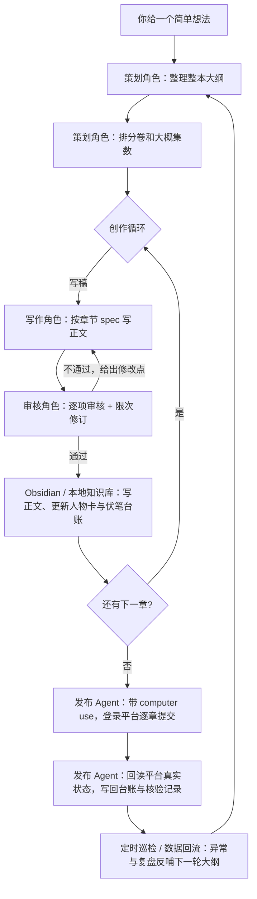

# 中文网文生产与发布工作流（可自选角色版）

一套把「一个想法 → 大纲 → 逐章创作 → 审核修订 → 本地知识库 → 平台提交 → 状态写回」串成闭环的工作流。
特点是**每个环节的角色都可替换**：你可以用 Gemini 策划、DeepSeek 写稿，也可以全程换成人或别的模型；
发布环节只需一个带 **computer use / 浏览器自动化**能力的 Agent 照着流程走。

> 这套流程是实战跑出来的：两部书共 326 章全部提交并在平台核验无缺章。踩过的坑写进了 `docs/10-平台实战踩坑.md`，别人接手不用重踩。

---

## 一、这套流程解决什么问题

1. **大纲先于正文**：先由一个"策划角色"把整本书的大纲、分卷、集数排出来，再开工，避免写到一半没剧情。
2. **写审分离**：写稿角色和审核角色不是同一个，避免自写自夸。两者循环迭代直到通过。
3. **外部记忆**：长篇必然超出模型上下文，用 Obsidian 当"外置大脑"存正文、人物卡、伏笔台账、续写断点，每次续写先读它，逻辑和伏笔才不断。
4. **提交有核对**：平台提交后必须回读真实状态并写回记录，不凭"点了提交"就当发布成功。
5. **角色可替换**：每个环节都给出"谁可以做"，你按手头免费额度、喜好自由组合。

---

## 二、全流程一张图



---

## 三、角色分工与"谁可以做"（核心）

**这是本仓库最重要的一节。流程写清楚，别人才拿去能用；角色写清楚，别人才能自由挑。**

| 环节 | 职责 | 默认推荐 | 可替换角色 | 省钱/免费提示 |
|---|---|---|---|---|
| 主 Agent（调度） | 拆任务、派发给各角色、汇总、盯进度 | WorkBuddy 的 Hy4-flash | Codex、Claude、任何能调用工具/子 Agent 的主模型 | 作者实测 Codex → WorkBuddy Hy4-flash；注意免费额度有截止日期，到期前确认新价格 |
| 策划 / 大纲 | 把想法扩展成整本大纲、分卷、集数 | Gemini | ChatGPT、Claude、网文策划专家、人工 | 长文结构能力优先 |
| 写稿 | 按章节 spec 写正文 | DeepSeek | WorkBuddy 自带 Flash、ChatGPT、人工 | 作者当前用 WorkBuddy 自带 4.1-flash，积分便宜、前期基本不花钱 |
| 审核 | 逐项审、限次修订、给 PASS/FAIL | Gemini | ChatGPT、审稿专家、朱雀检测、人工交叉审 | 审核与写稿**不要同一个角色** |
| 知识库 | 存正文/人物卡/伏笔/断点，补上下文 | Obsidian | 任意本地 Markdown 库、腾讯文档、数据库 | 这是长篇不断线的关键，别省 |
| 发布 Agent | 浏览器操作、逐章提交、状态核对 | 带 computer use 的 Agent | WorkBuddy、Codex、Playwright 脚本、浏览器扩展 | 必须能操作真实网页并回读 DOM |
| 决策人 | 登录、实名、签约、完结、最终拍板 | 你本人 | 只能是你 | 不要授权给任何 Agent |

**关于"为什么一开始用 Codex 后来用 WorkBuddy"**：主 Agent 需要能派发子任务、操作浏览器、读写本地文件。
作者早期用 Codex 做主 Agent，后期换成 WorkBuddy 的 Hy4-flash，理由是当时在免费期内、成本低。
这是**选型历史，不是硬性要求**——任何人按自己手头工具替换即可，流程不变。

**关于"后续上传直接是带 computer use 的 agent 就行"**：发布这一步不挑模型，挑的是"能不能操作浏览器"。
只要那个 Agent 能打开网页、填表、点击、读回页面文本，就能按 `docs/08-发布与状态写回.md` 执行。

> 提醒：任何"免费期"信息都有时效。作者信息记录的时间点是 2026-11，Hy4-flash 免费到 11-30；
> 后来者请以自己账号实际计费为准，不要照搬。

---

## 四、Obsidian 在流程里到底干什么（别跳过）

很多人以为 Obsidian 只是"写字的"，在这里它的作用是**外置记忆层**，专门补大模型的三个硬伤：

1. **补上下文**：200 章的正文不可能全塞进一次对话。每章开写前，Agent 先从 Obsidian 读「上一章正文 + 本章 spec + 人物卡 + 伏笔台账」，只带 necessary 上下文，逻辑才连得上。
2. **补逻辑一致性**：人物性格、设定边界、时间线都落在库里的固定文件，写新章前对照，避免前后矛盾。
3. **补伏笔**：伏笔台账记录「埋在哪章 / 计划在哪章收 / 实际收没收」，每章结束更新，长线不会断。
4. **断点续写**：`续写断点.md` 记录写到哪、下次从哪接，换模型、换会话都能无缝继续。

目录模板见 `templates/obsidian-vault/`。

---

## 五、目录结构

```
novel-workflow-kit/
├── README.md                      本文件：入门 + 角色选型
├── docs/
│   ├── 01-总流程.md                逐步 SOP，照着做
│   ├── 02-策划与大纲.md             Gemini 出大纲、排集数的方法
│   ├── 03-创作审核循环.md           DeepSeek↔Gemini loop，限次修订
│   ├── 04-Obsidian知识库.md         外置记忆层怎么建、怎么读
│   ├── 05-角色替换指南.md           每个角色怎么换、换的代价
│   ├── 06-主Agent派发.md            Codex/WorkBuddy 如何派发任务
│   ├── 07-计算机使用与浏览器能力.md  发布 Agent 需要什么能力
│   ├── 08-发布与状态写回.md         提交、核对、台账、验收
│   ├── 09-闭环与巡检.md             数据回流、异常自动发现
│   └── 10-平台实战踩坑.md           番茄后台实测规则与坑
├── prompts/                       可直接整段复制的提示词
│   ├── 00-主Agent派发.md
│   ├── 01-策划大纲.md
│   ├── 02-写稿.md
│   ├── 03-审核.md
│   ├── 04-修订.md
│   ├── 05-发布核对.md
│   └── 06-巡检与复盘.md
├── templates/
│   ├── 大纲模板.md
│   ├── 章节spec模板.md
│   ├── 人物卡模板.md
│   ├── 伏笔台账模板.md
│   ├── 审核记录模板.md
│   ├── 进度模板.md
│   └── obsidian-vault/             Obsidian 库目录示例
├── scripts/
│   ├── README.md                   脚本用途与适用平台
│   └── config.example.json         配置模板（脱敏）
├── examples/
│   └── 一次完整接力.md             从想法到发布的对话示例
├── config.example.json             全局配置示例（改成你自己的）
├── .gitignore
└── CHANGELOG.md
```

---

## 六、快速开始（给拿到仓库的人）

1. 复制 `config.example.json` 为 `config.json`，填入你自己的平台、账号、路径（**不要提交 config.json**）。
2. 按 `docs/05-角色替换指南.md` 决定每个环节用谁；把 `prompts/` 里对应提示词复制给你选的模型/Agent。
3. 给策划角色一个简单想法，用 `prompts/01-策划大纲.md` 生成整本大纲和集数。
4. 建 Obsidian 库（用 `templates/obsidian-vault/`），把大纲、人物卡、伏笔台账放进去。
5. 逐章跑 `prompts/02` → `prompts/03` → `prompts/04` 循环，PASS 后写回 Obsidian。
6. 全书完稿后，用带 computer use 的 Agent 按 `docs/08` 提交并核对。
7. 用 `prompts/06` 做定时巡检和数据复盘，反哺下一轮。

---

## 七、隐私与安全

- 本仓库**不含**任何真实账号、书号、Cookie、密钥、本机绝对路径；这些都在 `config.json`（已 gitignore）。
- 登录、验证码、实名、签约、完结申请**必须由本人操作**，任何 Agent 都不要代劳。
- 分享给朋友：GitHub 私密仓库 → Settings → Collaborators → 添加对方账号即可；对方 accept 后能读能改。
- 若只想给只读链接，可用 GitHub Gist 或导出 ZIP 后手工分发。

---

## 八、免责与时效

- 流程与脚本基于作者实战，但平台规则会变；发布前务必自己只读核对平台状态。
- 文中"免费额度""截止时间"是作者当时情况，后来者以实际为准。
- 本仓库不保证任何收益或上架结果，只保证流程可读、可改、可复用。
